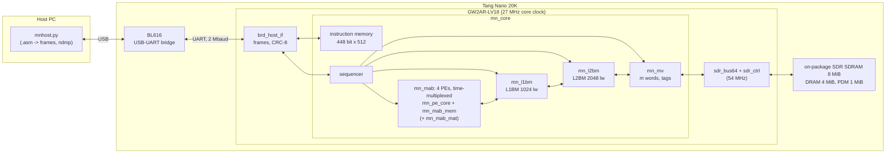

# Architecture

How the FPGA design runs MN-Core 2 machine code, as of milestone M2 (2026-11-25). Japanese: [ja/architecture.md](ja/architecture.md).

Measured results and bitstream totals are kept in one place, [README.md#results](../README.md#results). This document describes the structure, the rules for the reduced topology, and how the resources divide among the units. Sources are the work package reports in [`mncore/status/`](../mncore/status/) and the shared contract [`mncore/06-contracts.md`](../mncore/06-contracts.md) (Japanese).

## 1. Overview



The same structure as text, from the M2 report ([WP-37](../mncore/status/WP-37.md)):

```
brd_host_if ── mn_core ─┬─ instruction memory (448 bit x 512, 12 BSRAM), sequencer
                        ├─ mn_mab (4 PEs time-multiplexed) ── mn_pe_core ── mn_mab_mem (mn_pe_lsu / mn_pe_store, NPE = 4)
                        ├─ mn_l1bm (1 MAB, L1BM 1024 long words, $lbi, $lbf)
                        ├─ mn_l2bm (1 L1B, L2BM 2048 long words; writes L1BM through mn_l1bm's port B)
                        └─ mn_mv (m words, tags, PDM / DRAM) ── sd_* ── sdr_bus64 (board top, async) ── SDRAM
```

- One clock domain for the core: the 27 MHz board oscillator, without a PLL. Clock domain crossings exist only in `rtl/board` and `rtl/sdram` (contract §6). In M2 the SDRAM controller runs at 54 MHz from the rPLL ([WP-37](../mncore/status/WP-37.md)).
- The RTL is Verilog-2005, one module per file, prefix `mn_` (board: `brd_`, SDRAM: `sdr_`). Each unit passes iverilog `-Wall`, `verilator --lint-only -Wall` and `yosys synth_gowin` before it is merged (contract §6).

## 2. Host link

Specification: [`mncore/rtl/board/PROTOCOL.md`](../mncore/rtl/board/PROTOCOL.md) (version 1, Japanese). Measurements: [WP-04](../mncore/status/WP-04.md).

- Physical: UART 8N1 through the BL616 on the board (pins 69 = FPGA TX, 70 = FPGA RX). 1 Mbaud after reset; `SET_BAUD` switches to 2 Mbaud (recommended) or up to 3 Mbaud. If no valid frame arrives within one second after the switch, the FPGA falls back to the previous rate.
- Frame: `0xA5 | cmd u8 | len u16le | payload | crc8` (CRC-8/SMBUS). Commands: `PING` 0x01, `INFO` 0x02, `WR_IMEM` 0x03, `WR_MEM` 0x04, `RD_MEM` 0x05, `RUN` 0x06, `STATUS` 0x07, `RESET` 0x08, `SET_BAUD` 0x09. A payload is executed only after its CRC checks.
- Memory spaces (all addresses in 64-bit long words): 0 IMEM, 1 LM0, 2 LM1, 3 GRF0, 4 GRF1, 5 T, 6 L1BM, 7 L2BM, 8 PDM, 9 DRAM, 15 TEST, 0x10 OMR, 0x11 BAR (`$mb` / `$nb`). Location: `loc = n<<10 | c<<9 | b<<6 | m<<2 | p`, in chip coordinates.
- `INFO` reports the design ID (0x02 `mn_top_1pe`, 0x03 `mn_top_mab`, 0x04 `mn_top_m2`), the implemented topology, the depth of each space, and flags for the units in the bitstream: bits 3..2 FPALU, bit 4 MAU, bit 5 BFN, bit 6 MAT, bit 7 REPLICA. The host uses them to expand `d set` to the implemented PEs and to pick the RTL results of the same configuration.
- Bridge limits: reads from the FPGA run at about 70 KiB/s at any baud rate. The host keeps at most 6,300 bytes of responses outstanding, because the bridge drops bytes beyond about 8–10 KB. The FPGA never sends without a request. Ctrl-X or Ctrl-C sent alone puts the BL616 into its shell; `mnhost.py bridge reboot` recovers it.

`mnhost.py run X.asm` turns an `.asm` file into commands: `RESET`, `j` / `m` words → `WR_IMEM` (in windows of 512 entries for longer programs), `d set` and `r` lines → `WR_MEM`, `RUN` split at each `d` line, `d get` → `RD_MEM`. The result is written as a normalized dump (`.ndmp`) in the same format as the reference tools, so `ndiff.py` compares them directly.

## 3. Instruction memory and sequencing

- Each entry is 448 bits: `[447:446]` the kind (01 `j`, 10 `m`) and `[425:0]` the word (`m` words in `[81:0]`). The host writes the 7 lanes of an entry in order. 512 entries use 12 BSRAM blocks ([WP-07](../mncore/status/WP-07.md), [WP-20](../mncore/status/WP-20.md)).
- Bit order: position 0 is the leftmost character of the `j` line; in Verilog, `jw[425-pos]` is position `pos` (contract §2).
- `RUN(start, count)` executes entries in order. Stop reasons in `STATUS`: 0 `OK`, 1 `E_RANGE` (info = entry), 2 `E_UNSUPPORTED` (info = field number; bit 7 set for an `m` field), 3 `E_DECODE` (`ll` = 10 or a bad entry kind), 4 `WAIT` (info = tag; the program waited for a tag that no MV has completed, where the official emulator stays stopped until the end).
- `ll` (the first two bits) controls the whole word: 01 normal, 11 noforward (writes happen but forwarding registers and `$lbi` keep their values), 00 nop (nothing is written, but the `wd` wait field still applies), 10 stops with `E_DECODE`.
- `RESET` sets the PE state (GRF, LM, T, OMR, `$mb` / `$nb`) to zero, so every program starts like the official emulator. In M2 it also clears L1BM, `$lbi`, L2BM, the MV tags, and the DRAM / PDM area of the SDRAM.

**One `j` word in M2** ([WP-37](../mncore/status/WP-37.md), `mn_core.v`):

| Step | What happens |
| --- | --- |
| 1 | If `wd` ≠ 0: wait until MV is idle, then check the tag. One completion: consume it and continue. None: stop with `WAIT`. Two or more: `E_UNSUPPORTED wd` (the official emulator aborts) |
| 2 | `ll` = 00: tell `mn_l2bm` to skip, go to the next word. Check the unit ranges; on failure stop with `E_RANGE` before anything is written. A word with an L2BM part waits until MV is idle (the official emulator completes MV at issue) |
| 3 | `mn_mab` runs the word on PE 0..3: a check-only pass (range and unsupported checks for all 4 PEs), then the normal pass. In the normal pass each PE sends its operand to L1BM, receives L1BM values, and reads or writes `$lbf` |
| 4 | `mn_l2bm` first half (read L1BM, write L2BM) → `mn_l1bm` commit (L1BM and `$lbi`) → `mn_l2bm` commit (write L1BM). This is the order inside a word that the official emulator uses |
| 5 | Words without an L2BM part still tell `mn_l2bm` that a word went by (needed for consecutive `l2bmdars`) |

An `m` word starts `mn_mv`, waits for its check (OK, `E_RANGE` or `E_UNSUPPORTED`), and continues while the transfer runs in the background. PE and L1BM words may execute during a transfer. `RUN` reports completion only after all transfers have finished.

## 4. PE core

`mn_pe_core` executes one PE step through `mn_pe_lsu` in three phases ([WP-14](../mncore/status/WP-14.md), [WP-20](../mncore/status/WP-20.md)):

1. **start**: compute the LM addresses of all 4 cycles (flat cycle-0..3 address fields, `$mb` / `$nb`, T-indirect, `j<madpe>`) and check every access against the reduced capacities. On failure nothing is read or written, and the core stops with `E_RANGE`. Writes that the mask suppresses are checked too.
2. **READ**: read the memories the word uses as inputs (GRF0, GRF1, LM0, LM1) into a buffer. All reads in a step see the state before the step.
3. **EXEC**: for cycles 0..3, gather the operands on a shared 128-bit bus, issue them to the integer ALU, the FP ALU and the vector MAU, and write the results through the masks, the zero flush and `$omr`.

- The decoder `mn_dec_j` / `mn_dec_m` is generated from the ISA schema by `mncore/tools/gen_dec.py` and is not edited by hand ([WP-10](../mncore/status/WP-10.md)).
- Integer ALU `mn_alu_int` ([WP-11](../mncore/status/WP-11.md)), FP ALU `mn_fp_alu` and block-float conversion `mn_fp_alu_bfn` ([WP-13](../mncore/status/WP-13.md)), FMA `mn_fp_fma` and vector MAU `mn_mau_vec` ([WP-12](../mncore/status/WP-12.md)). All follow the official emulator where it differs from the Rust simulator ([divergences.md](divergences.md)).
- Forwarding registers `$aluf` / `$mauf` / `$lbf` / `$mreadf` are kept per PE and cycle in LUT RAM or BSRAM.
- Speed at 27 MHz: about 33 clocks per executed word for 1 PE ([WP-20](../mncore/status/WP-20.md)). The UART transfer dominates the run time on the board.

## 5. MAB: 4 PEs on one datapath

One PE already takes 71–75 % of the LUT4s, so the 4 PEs of a MAB share one datapath and run one after another ([`mncore/wp/WP-3x.md`](../mncore/wp/WP-3x.md), [WP-30](../mncore/status/WP-30.md)).

- **Check-only pass**: for words that touch LM, cross PEs (`msl` / `msr` / `bfn` / `bfe`), or use the L1BM / L2BM units or the matrix MAU, PE 0..3 are first run without writing. This collects the operands that other PEs need and checks ranges. If any PE is out of range, no PE writes anything (`E_RANGE`).
- **Normal pass**: PE 0..3 execute the word. Cross-PE results come from the exchange buffer: `msl` / `msr` give {the neighbour's MSB long word, 0} with zero flags into `$aluf`; `bfn` / `bfe` convert the 4 PEs' values together.
- **PE state**: LM0 / LM1 / GRF0 / GRF1 for 4 PEs in BSRAM, addressed by {PE, address} (16 blocks with LM of 256 long words). T, the mask registers and `$mb` / `$nb` are per-PE registers inside `mn_pe_lsu` (`NPE = 4`, [WP-35](../mncore/status/WP-35.md), [WP-37](../mncore/status/WP-37.md)).
- **Matrix unit** (`MAT = 1`, `mn_mab_mat`, [WP-36](../mncore/status/WP-36.md)): the X / Y matrix registers of the MAB (one per MAB, zero after reset, not visible to the host), `?mwrite`, the transposed read for `?mread` and `$mreadf`, and the block-float `?mfma` / `?mmul` for f, g and h. Products are summed exactly with one 18×18 multiplier and rounded once at the end. The d-precision matrix MAU is not implemented (`E_UNSUPPORTED`).
- Speed: about 183 clocks per word for all 4 PEs ([WP-37](../mncore/status/WP-37.md)). A half-precision matrix multiply word takes about 9,400 clocks ([WP-36](../mncore/status/WP-36.md)).

## 6. L1BM, L2BM, MV and SDRAM

**L1BM** (`mn_l1bm`, [WP-31](../mncore/status/WP-31.md), [`mncore/rtl/l1bm/README.md`](../mncore/rtl/l1bm/README.md)):

- L1BM of 1024 long words (4 BSRAM), the turnaround register `$lbi` and `$lbf`.
- Reductions (RRN) use a small network specialised for one MAB (`RRN = 2`); a general 16-MAB network (`RRN = 1`) exists and is tested with 64 PEs.
- L1BM and `$lbi` are written only at commit, after all 4 PEs, so every read in the word sees the state before it.
- The PE → L1BM operand with `isel` = 111 is `$lbf` ([WP-37](../mncore/status/WP-37.md)).

**L2BM** (`mn_l2bm`, [WP-32](../mncore/status/WP-32.md), [`mncore/rtl/l2bm/README.md`](../mncore/rtl/l2bm/README.md)):

- L2BM of 2048 long words (8 BSRAM), the 9 L2BM instruction forms, and reductions over the L1B set.
- DAR and the DAR buffer are built with `DAR = 0` in M2 (3 BSRAM saved). `l2bmdars` / `l2bmdarw` therefore stop with `E_UNSUPPORTED`, and indirect MV addressing reads DAR as 0. The 19 corpus programs that use `$di` need a `DAR = 1` bitstream ([WP-33](../mncore/status/WP-33.md)).

**MV** (`mn_mv`, [WP-33](../mncore/status/WP-33.md), [`mncore/rtl/mv/README.md`](../mncore/rtl/mv/README.md)):

- Decodes `m` words, including the 4 forms that the official emulator runs but `assemble3` never emits.
- Moves data in chunks of 16 long words through a LUT-RAM buffer, with reductions and DRAM indirect addressing.
- Counts 256 tags ("completed and not yet waited for": 0, 1, or 2 or more).
- A transfer takes about 2.3–2.8 core clocks per long word between L2BM and SDRAM.

**SDRAM** (`sdr_bus64` + `sdr_ctrl`, [WP-05](../mncore/status/WP-05.md), [`mncore/rtl/sdram/README.md`](../mncore/rtl/sdram/README.md)):

- The on-package 64 Mbit SDR SDRAM, organized as 2^20 long words; one long word is a burst of two 32-bit columns.
- M2 uses 54 MHz, CL2, phase 11, `cfg_rdx` = 1. That setting passed the whole-memory test on the board ([WP-05](../mncore/status/WP-05.md)); 99 MHz was not reached after place and route in the full design ([WP-37](../mncore/status/WP-37.md)).
- The core side is single-clock; `sdr_bus64` crosses to the SDRAM clock with asynchronous FIFOs.

| SDRAM long-word address | Size | Use |
| --- | --- | --- |
| 0x00000–0x7FFFF | 2^19 long words (4 MiB) | DRAM of group 0 (`DRAM_DEPTH`) |
| 0x80000–0x9FFFF | 2^17 long words (1 MiB) | PDM of group 0 (`PDM_DEPTH`) |
| 0xA0000–0xFFFFF | 3 MiB | free (planned for the virtual PE, WP34) |

These depths hold everything the corpus touches: at most 208,064 DRAM long words and 32,768 PDM long words ([WP-33](../mncore/status/WP-33.md)).

## 7. Reduced topology

Contract §3; the Rust simulator defines the same semantics in `third_party/mncore/viz/core/docs/topology.md` ([WP-06](../mncore/status/WP-06.md)).

| Parameter | MN-Core 2 | M2 bitstreams |
| --- | --- | --- |
| Groups (with PDM / DRAM / DAR) | 4 | 1 (group 0) |
| L2B per chip / L1B per L2B / MAB per L1B / PE per MAB | 8 / 8 / 16 / 4 | 1 / 1 / 1 / 4 |
| LM0 / LM1 per PE | 2048 long words | 256 long words |
| GRF0 / GRF1 per PE | 256 long words | 256 long words |
| L1BM / L2BM | 8192 / 32768 long words | 1024 / 2048 long words |
| PDM / DRAM per group | 2^19 / 2^29 long words (4 MiB / 4 GiB) | 2^17 / 2^19 long words (1 MiB / 4 MiB) |

- **Coordinates**: the implemented units are the first ones in chip order: PEs `n0c0b0m0p0`..`p3`, L1B `n0c0b0`, L2B `n0c0`, group 0. `$peid`, `$l1bid`, `$l2bid`, `$mabid` and `$subpeid` return chip values.
- **Capacity**: an address is first wrapped at the chip size (L2BM 2^15, PDM 2^19, DRAM 2^29 long words for MV), then compared with the reduced capacity. Only accesses that actually happen are checked; `assemble3` fills unused address fields too, so field values alone decide nothing. Writes suppressed by a mask are checked. On a failure the program stops with `E_RANGE` and the entry number; nothing of that word is written.
- **Missing units** (the other MABs, L1Bs, L2Bs and groups):
  - Transfers to a missing unit are dropped.
  - **Zero rule** (default): a reduction or gather input from a missing unit is the value zero, not the identity element. L1BM gathers write 0 at the positions of missing MABs. The exception: in `l2bmr`, L1Bs outside the instruction's set send the identity element, as on the chip.
  - **Replica rule** (`REPLICA = 1`, [WP-37](../mncore/status/WP-37.md)): a missing MAB m is a copy of MAB `m mod N_MAB`, a missing L1B b a copy of L1B `b mod N_L1B`. Reduction, gather and `l2bmi` inputs and `$lbi` reads take the copy's value; writes to missing units are dropped. A reduction of n equal values is computed from one value: fadd adds log2 n to the exponent (exact, one rounding), iadd multiplies by n, max / min / band / bor return the value, and / or return 1 if the value is non-zero.
- **Which reference applies**:
  - The official emulator always runs 4096 PEs, and the implemented part is cut out of its dump.
  - When the data stays inside the implemented units, that cut is the reference under both rules ("pass b").
  - Otherwise the zero-rule reference is the Rust simulator run on the reduced topology ("pass c", `mncore/sim/regress/topo_rs`). For instructions where the Rust simulator is known to differ from the official emulator, the RTL follows the official rule.
  - The replica-rule reference is the official cut. It matches only programs in which every unit holds the same data.

## 8. Function-specific bitstreams

One bitstream cannot hold every unit. Parameters of the board tops (`mn_top_1pe`, `mn_top_mab`, `mn_top_m2`) choose the units, and `INFO` reports them:

| Parameter | Values |
| --- | --- |
| `FPALU` | 0 no FP ALU; 1 full; 2 without floor / ftoi; 3 also without fmax / fmin (keeps relu, lrelu, rsqrt) |
| `MAU` | vector MAU (FMA, 8 DSP) on / off |
| `BFN` | block-float conversion `bfn` / `bfe` (needs 4 PEs) |
| `MAT` | matrix unit |
| `REPLICA` | replica rule for missing MABs / L1Bs |

Bitstreams used on the board at M2 (the measured LUT4 and Fmax are in [README.md#results](../README.md#results)):

| Name | Design | Units |
| --- | --- | --- |
| M1 | `mn_top_1pe` | 1 PE, integer ALU, FP ALU `FPALU=3`, MAU |
| A | `mn_top_mab` | 4 PEs, integer ALU, MAU |
| B | `mn_top_mab` | 4 PEs, integer ALU, FP ALU `FPALU=3`, bfn |
| matrix | `mn_top_mab` | 4 PEs, integer ALU, bfn, matrix unit |
| M2a | `mn_top_m2` | 4 PEs, integer ALU, L1BM, L2BM, MV, SDRAM (zero rule) |
| M2a-R | `mn_top_m2` | as M2a, replica rule |

A program that needs units from two bitstreams can be split between words. The host runs the first part, reads the PE state (GRF0 / GRF1 / LM0 / LM1 / T / OMR / `$mb` / `$nb` of PE 0..3), loads the other bitstream, writes the state back and runs the rest (`mncore/fpga/top_m2/hello_hw.py`).

The hand-over is exact only if the later words do not read state the host cannot transfer: forwarding registers, `$lbi`, MV tags, DAR, and matrix registers. The script checks the operand selectors of the later words and refuses otherwise. At M2 this is done by hand for hello_world; automatic switching is WP38 (in progress).

## 9. Resource breakdown

Totals per bitstream are in [README.md#results](../README.md#results). The breakdown below is for M2 ([WP-37](../mncore/status/WP-37.md)), from yosys `synth_gowin -nowidelut`. "LUT-equivalent" = LUT + ALU + 8 × RAM16SDP4, because nextpnr counts one RAM16SDP4 as 8 LUT sites ([WP-21](../mncore/status/WP-21.md)).

BSRAM in M2a (43 of 46):

| Use | Blocks |
| --- | ---: |
| Instruction memory (448 bit × 512) | 12 |
| PE memories of 4 PEs (LM0 / LM1 / GRF0 / GRF1, 256 long words each) | 16 |
| L1BM (1024 long words) | 4 |
| L2BM (2048 long words) | 8 |
| Host interface (`brd_host_if` FIFOs and receive buffer) | 3 |

LUT-equivalent of the main parts (hierarchical synthesis of the M2 configuration with the MAU, [WP-37](../mncore/status/WP-37.md)):

| Part | LUT-equivalent |
| --- | ---: |
| `mn_pe_lsu` (PE memory sequencing, 4 PEs) | 2,611 |
| `mn_fp_fma` (vector MAU FMA) | 2,471 |
| `mn_l1bm` | 1,765 |
| `mn_pe_core` (gather, forwarding, control) | 1,430 |
| `brd_host_if` | 1,372 |
| `mn_alu_int` | 1,366 |
| `mn_mv` (with its reduction and tag submodules: 1,329) | 1,132 |
| `mn_l2bm` | 1,131 |
| `mn_mau_vec` (own logic, without the FMA) | 1,062 |
| `mn_core` (instruction memory assembly, sequencing, clearing, host spaces) | 1,003 |
| SDRAM (`sdr_ctrl`, FIFOs, `sdr_bus64`) | about 860 |
| `mn_fp_mul53` | 453 |

- Adding the MAU to M2a costs about 5,000 LUT-equivalents, which is why M2 with the MAU does not fit.
- The replica rule adds 538 ([WP-37](../mncore/status/WP-37.md)).
- The matrix unit adds 2,379–2,763 at the board top, plus 3 BSRAM and 1 DSP ([WP-36](../mncore/status/WP-36.md)).
- The FP ALU is about 2,200 (about 1,200 without floor / ftoi), and block-float conversion about 3,500 ([WP-35](../mncore/status/WP-35.md), [WP-30](../mncore/status/WP-30.md)).
- The vector MAU uses 8 of the 48 18×18 multipliers ([WP-12](../mncore/status/WP-12.md)).

## 10. Verification flow

- **Unit level**: `.vec` files from `mncore/vecgen` (Rust, black-box runs of the Rust simulator). Rows where the simulator differs from the official emulator are replaced with the official output. The RTL testbenches read them. Small fixed samples are committed under `mncore/sim/vectors_fixed/` ([WP-03](../mncore/status/WP-03.md)).
- **Directed programs**: each unit has `.vsm` tests whose expected values come from the official emulator. They are stored as scripts (`fixed/*.scr`, `*.tst`), so `python mncore/tools/simrun.py <unit>` needs neither WSL nor the official tools.
- **Corpus regression**: `mncore/sim/regress/run.py` runs every comparable corpus program on the official emulator (cached), on the reduced Rust simulator (M2), and on the RTL. It compares normalized dumps (`.ndmp`, contract §4). `mncore/fpga/*/hwrun.py` runs the same inputs on the board and also checks that the board equals the RTL simulation of the same configuration.
- **Mutation tests**: `mutate.py` in the core, MAB, matrix and decoder testbenches inserts faults and checks that the tests catch every one ([WP-37](../mncore/status/WP-37.md)).
