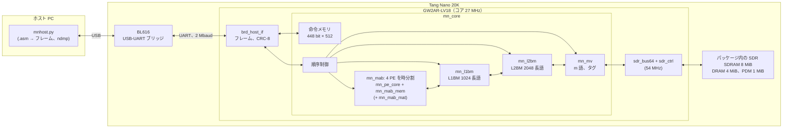

# アーキテクチャ

マイルストーン M2（2026-11-25）の時点で、FPGA のデザインがどのように MN-Core 2 の機械語を実行するかをまとめる。English: [../architecture.md](../architecture.md)

実測の結果と、ビットストリームごとの資源の合計は、[README.md の Results](../../README.md#results) の 1 か所にまとめている。この文書には、構成、縮小トポロジの規則、ユニットごとの資源の内訳を書く。

出典は [`mncore/status/`](../../mncore/status/) の各報告書と、共通契約 [`mncore/06-contracts.md`](../../mncore/06-contracts.md)。

## 1. 全体の構成



同じ構成を文字で書いたもの（[WP-37](../../mncore/status/WP-37.md)）:

```
brd_host_if ── mn_core ─┬─ 命令メモリ（448 bit × 512、BSRAM 12）、順序制御
                        ├─ mn_mab（4 PE の時分割）── mn_pe_core ── mn_mab_mem（mn_pe_lsu / mn_pe_store、NPE = 4）
                        ├─ mn_l1bm（1 MAB、L1BM 1024 長語、$lbi、$lbf）
                        ├─ mn_l2bm（1 L1B、L2BM 2048 長語。L1BM へは mn_l1bm のポート B）
                        └─ mn_mv（m 語、タグ、PDM / DRAM）── sd_* ── sdr_bus64（ボードのトップ、非同期）── SDRAM
```

- **クロック**:
  - コアは単一クロックで、基板の発振器の 27 MHz をそのまま使う（PLL は使わない）。
  - クロックをまたぐのは `rtl/board` と `rtl/sdram` の中だけ（契約 §6）。
  - M2 では SDRAM の制御器を rPLL の 54 MHz で動かす（[WP-37](../../mncore/status/WP-37.md)）。
- **RTL の規約**:
  - Verilog-2005 で、1 ファイルに 1 モジュール。接頭辞は `mn_`（ボードは `brd_`、SDRAM は `sdr_`）。
  - 各ユニットは、マージの前に iverilog の `-Wall`、`verilator --lint-only -Wall`、`yosys synth_gowin` を通す（契約 §6）。

## 2. ホストとの通信

仕様は [`mncore/rtl/board/PROTOCOL.md`](../../mncore/rtl/board/PROTOCOL.md)（版 1）、実測は [WP-04](../../mncore/status/WP-04.md)。

- **物理層**: ボード上の BL616 を通る UART、8N1。ピンは 69 が FPGA の送信、70 が FPGA の受信。
  - リセット後は 1 Mbaud。`SET_BAUD` で 2 Mbaud（推奨）か、最大 3 Mbaud に切り替える。
  - 切り替えの後 1 秒以内に正しいフレームが来なければ、元の速度に戻る。
- **フレーム**: `0xA5 | cmd u8 | len u16le | payload | crc8`（CRC-8/SMBUS）。ペイロードは CRC を確かめてから実行する。
  - コマンドは `PING` 0x01、`INFO` 0x02、`WR_IMEM` 0x03、`WR_MEM` 0x04、`RD_MEM` 0x05、`RUN` 0x06、`STATUS` 0x07、`RESET` 0x08、`SET_BAUD` 0x09。
- **空間**（アドレスはすべて 64bit の長語単位）: 0 IMEM、1 LM0、2 LM1、3 GRF0、4 GRF1、5 T、6 L1BM、7 L2BM、8 PDM、9 DRAM、15 TEST、0x10 OMR、0x11 BAR（`$mb` / `$nb`）。
  - 位置は `loc = n<<10 | c<<9 | b<<6 | m<<2 | p`（チップ上の座標）。
- **INFO** が返すもの:
  - デザイン ID（0x02 `mn_top_1pe`、0x03 `mn_top_mab`、0x04 `mn_top_m2`）
  - 実装したトポロジと、空間ごとの深さ
  - 載っているユニットのフラグ（bit 3..2 FPALU、bit 4 MAU、bit 5 BFN、bit 6 MAT、bit 7 REPLICA）

  ホストはこれを見て、`d set` を実装した PE だけに展開し、同じ構成の RTL の結果を選ぶ。
- **ブリッジの制約**:
  - FPGA からの読み出しは、ボーレートによらず約 70 KiB/s が上限。
  - ブリッジに約 8〜10 KB たまるとバイトが落ちるので、ホストは未受信の応答を 6,300 バイト以下に保つ。
  - FPGA は要求なしに送らない。
  - Ctrl-X や Ctrl-C を単独で送ると BL616 がシェルに入る。`mnhost.py bridge reboot` で戻る。

`mnhost.py run X.asm` は `.asm` を次のコマンドの列に変える。

- 最初に `RESET`。
- `j` / `m` 語 → `WR_IMEM`（512 エントリを超えるプログラムは窓に分ける）。
- `d set` と `r` 行 → `WR_MEM`。
- `RUN` は `d` 行の位置で分ける。
- `d get` → `RD_MEM`。

結果は正解のツールと同じ形式の正規化ダンプ（`.ndmp`）で書くので、`ndiff.py` でそのまま比べられる。

## 3. 命令メモリと順序制御

- **エントリ**: 448bit。`[447:446]` が種類（01 `j`、10 `m`）、`[425:0]` が命令語（`m` 語は `[81:0]`）。
  - ホストは 1 エントリの 7 レーンを順に書く。
  - 512 エントリで BSRAM 12 ブロック（[WP-07](../../mncore/status/WP-07.md)、[WP-20](../../mncore/status/WP-20.md)）。
- **ビットの番号**: `j` 行の左端の文字が位置 0。Verilog では `jw[425-pos]` が位置 `pos`（契約 §2）。
- **`RUN(start, count)`** はエントリを順に実行する。`STATUS` の停止理由:

  | 値 | 理由 | info |
  | --- | --- | --- |
  | 0 | `OK` | |
  | 1 | `E_RANGE` | エントリ番号 |
  | 2 | `E_UNSUPPORTED` | 欄の番号（`m` 語の欄なら bit 7 が 1） |
  | 3 | `E_DECODE` | `ll` = 10 や、エントリの種類が不正なとき |
  | 4 | `WAIT` | タグ。完了した MV のないタグを待った。公式エミュレータはそこで止まったまま終わる |

- **`ll`**（先頭 2bit）は語全体の実行を決める。
  - 01: 通常。
  - 11: noforward。書き込みはするが、フォワーディングレジスタと `$lbi` を更新しない。
  - 00: nop。何も書かない。ただし wait の欄 `wd` は有効。
  - 10: `E_DECODE` で止まる。
- **`RESET`** で PE の状態（GRF、LM、T、OMR、`$mb` / `$nb`）を 0 にするので、どのプログラムも公式エミュレータと同じ状態から始まる。
  - M2 ではさらに、L1BM、`$lbi`、L2BM、MV のタグ、SDRAM の DRAM / PDM の領域も 0 にする。

**M2 での `j` 語 1 語の処理**（[WP-37](../../mncore/status/WP-37.md)、`mn_core.v`）:

| 段 | すること |
| --- | --- |
| 1 | `wd` ≠ 0 なら、MV が終わるのを待ってタグを見る。完了が 1 つなら消費して進む。0 なら `WAIT` で止まる。2 つ以上なら `E_UNSUPPORTED wd`（公式は異常終了する） |
| 2 | `ll` = 00 なら `mn_l2bm` に読み飛ばしを伝えて次へ進む。ユニットの範囲を検査し、だめなら何も書かずに `E_RANGE` で止まる。L2BM の部分がある語は、MV が終わるのを待つ（公式は MV を発行の時点で終える） |
| 3 | `mn_mab` が PE 0〜3 で語を実行する。まず検査だけのパス（4 PE 分の範囲と未対応の検査）、次に通常のパス。通常のパスでは、PE ごとに L1BM へオペランドを渡し、L1BM からの値を受け、`$lbf` を読み書きする |
| 4 | `mn_l2bm` の前半（L1BM を読み、L2BM に書く）→ `mn_l1bm` の確定（L1BM と `$lbi`）→ `mn_l2bm` の確定（L1BM に書く）。公式エミュレータの、語の中の順序に合わせた |
| 5 | L2BM の部分のない語でも、語が通ったことを `mn_l2bm` に伝える（連続する `l2bmdars` の判定に要る） |

`m` 語は `mn_mv` を始動させ、検査の結果（OK、`E_RANGE`、`E_UNSUPPORTED`）を待って次へ進む。転送は裏で続く。

- PE と L1BM だけの語は、転送中も実行してよい。
- `RUN` は、すべての転送が終わってから完了を報告する。

## 4. PE コア

`mn_pe_core` は、PE の 1 ステップを `mn_pe_lsu` の 3 段で実行する（[WP-14](../../mncore/status/WP-14.md)、[WP-20](../../mncore/status/WP-20.md)）。

1. **start**: 4 サイクル分の LM のアドレスを計算し（flat の cycle0〜3 のアドレス欄、`$mb` / `$nb`、T 間接、`j<madpe>`）、すべてのアクセスを縮小した容量と比べる。
   - 範囲外なら何も読み書きせず、`E_RANGE` で止まる。
   - マスクで止まる書き込みも検査する。
2. **READ**: 入力として使うメモリ（GRF0、GRF1、LM0、LM1）をバッファに読む。ステップの中の読み出しは、すべてステップの前の状態を見る。
3. **EXEC**: サイクル 0〜3 について、次の順に処理する。
   - 共有の 128bit のバスでオペランドを集める。
   - 整数 ALU、FP ALU、ベクトル MAU に渡す。
   - マスク、ゼロフラッシュ、`$omr` を通して結果を書く。

- **デコーダ**: `mn_dec_j` / `mn_dec_m` は、ISA の定義から `mncore/tools/gen_dec.py` が生成する。手で編集しない（[WP-10](../../mncore/status/WP-10.md)）。
- **演算器**: いずれも、Rust Sim と食い違う所では公式エミュレータに合わせた（[divergences.md](../divergences.md)）。
  - 整数 ALU `mn_alu_int`（[WP-11](../../mncore/status/WP-11.md)）
  - FP ALU `mn_fp_alu` とブロックフロート化 `mn_fp_alu_bfn`（[WP-13](../../mncore/status/WP-13.md)）
  - FMA `mn_fp_fma` とベクトル MAU `mn_mau_vec`（[WP-12](../../mncore/status/WP-12.md)）
- **フォワーディングレジスタ**: `$aluf` / `$mauf` / `$lbf` / `$mreadf` は、PE とサイクルごとに LUT RAM か BSRAM に持つ。
- **速さ**: 27 MHz で、1 PE の構成では実行する 1 語あたり約 33 クロック（[WP-20](../../mncore/status/WP-20.md)）。実機での実行時間は UART の転送が律速。

## 5. MAB: 4 PE で 1 組のデータパスを使う

1 PE だけで LUT4 の 71〜75 % を使う。そのため MAB の 4 PE は 1 組のデータパスを共有し、順番に実行する（[`mncore/wp/WP-3x.md`](../../mncore/wp/WP-3x.md)、[WP-30](../../mncore/status/WP-30.md)）。

- **検査だけのパス**: 次のどれかに当たる語では、まず PE 0〜3 を書き込みなしで実行する。
  - 対象: LM を使う語、PE をまたぐ語（`msl` / `msr` / `bfn` / `bfe`）、L1BM / L2BM のユニットか行列 MAU を使う語。
  - このパスで、ほかの PE が要るオペランドを集め、範囲を検査する。
  - どれかの PE が範囲外なら、どの PE も書かずに `E_RANGE` で止まる。
- **通常のパス**: PE 0〜3 が語を実行する。PE をまたぐ命令の結果は受け渡しバッファから取る。
  - `msl` / `msr` の結果は {隣の PE の MSB 側の長語, 0} で、フラグは 0。`$aluf` に入る。
  - `bfn` / `bfe` は 4 PE の値をまとめて変換する。
- **PE の状態**:
  - 4 PE 分の LM0 / LM1 / GRF0 / GRF1 は、{PE, アドレス} で引く BSRAM に置く（LM 256 長語で 16 ブロック）。
  - T、マスクレジスタ、`$mb` / `$nb` は、`mn_pe_lsu` の中の PE ごとのレジスタ（`NPE = 4`、[WP-35](../../mncore/status/WP-35.md)、[WP-37](../../mncore/status/WP-37.md)）。
- **行列ユニット**（`MAT = 1`、`mn_mab_mat`、[WP-36](../../mncore/status/WP-36.md)）が持つもの:
  - MAB の行列レジスタ X / Y（MAB に 1 つ。リセットで 0。ホストからは見えない）
  - `?mwrite`
  - `?mread` と `$mreadf` のための転置読み出し
  - f / g / h のブロックフロートの `?mfma` / `?mmul`。積は 18×18 の乗算器 1 個で厳密に足し、最後に 1 回だけ丸める。

  倍精度の行列 MAU は実装していない（`E_UNSUPPORTED`）。
- **速さ**:
  - 4 PE 分で 1 語あたり約 183 クロック（[WP-37](../../mncore/status/WP-37.md)）。
  - 半精度の行列積の語は約 9,400 クロック（[WP-36](../../mncore/status/WP-36.md)）。

## 6. L1BM、L2BM、MV、SDRAM

**L1BM**（`mn_l1bm`、[WP-31](../../mncore/status/WP-31.md)、[`mncore/rtl/l1bm/README.md`](../../mncore/rtl/l1bm/README.md)）:

- 1024 長語の L1BM（BSRAM 4）、折り返しのレジスタ `$lbi`、`$lbf` を持つ。
- 縮約（RRN）は 1 MAB 専用の小さな網（`RRN = 2`）で行う。16 MAB 用の一般の網（`RRN = 1`）もあり、64 PE で試験した。
- L1BM と `$lbi` は 4 PE が終わった後の確定でだけ書く。そのため、語の中の読み出しはすべて語の前の状態を見る。
- `isel` = 111 の PE → L1BM のオペランドは `$lbf`（[WP-37](../../mncore/status/WP-37.md)）。

**L2BM**（`mn_l2bm`、[WP-32](../../mncore/status/WP-32.md)、[`mncore/rtl/l2bm/README.md`](../../mncore/rtl/l2bm/README.md)）:

- 2048 長語の L2BM（BSRAM 8）、L2BM 命令の 9 形式、L1B の集合に対する縮約を持つ。
- M2 では DAR と DAR バッファを入れない（`DAR = 0`。BSRAM 3 の節約）。
  - そのため `l2bmdars` / `l2bmdarw` は `E_UNSUPPORTED` で止まり、MV の間接参照は DAR を 0 として読む。
  - `$di` を使うコーパスの 19 本には、`DAR = 1` のビットストリームが要る（[WP-33](../../mncore/status/WP-33.md)）。

**MV**（`mn_mv`、[WP-33](../../mncore/status/WP-33.md)、[`mncore/rtl/mv/README.md`](../../mncore/rtl/mv/README.md)）:

- `m` 語を解読する。`assemble3` は出さないが公式エミュレータは動かす 4 つの形にも対応する。
- 16 長語のチャンク単位で、LUT RAM のバッファを通して転送する。縮約と DRAM の間接参照も行う。
- 256 個のタグを数える（「完了して、まだ wait していない数」が 0、1、2 以上）。
- L2BM と SDRAM の間の転送は、コアのクロックで 1 長語あたり約 2.3〜2.8 クロック。

**SDRAM**（`sdr_bus64` + `sdr_ctrl`、[WP-05](../../mncore/status/WP-05.md)、[`mncore/rtl/sdram/README.md`](../../mncore/rtl/sdram/README.md)）:

- パッケージ内の 64 Mbit の SDR SDRAM を、2^20 長語として使う。1 長語は 32bit の列 2 つのバースト。
- M2 は 54 MHz、CL2、位相 11、`cfg_rdx` = 1 で動かす。
  - この設定は実機で全域試験を通った（[WP-05](../../mncore/status/WP-05.md)）。
  - 99 MHz は、全体のデザインでは配置配線の後に届かなかった（[WP-37](../../mncore/status/WP-37.md)）。
- コア側は単一クロック。`sdr_bus64` が非同期 FIFO で SDRAM のクロックに乗せ換える。

| SDRAM の長語アドレス | 大きさ | 用途 |
| --- | --- | --- |
| 0x00000〜0x7FFFF | 2^19 長語（4 MiB） | グループ 0 の DRAM（`DRAM_DEPTH`） |
| 0x80000〜0x9FFFF | 2^17 長語（1 MiB） | グループ 0 の PDM（`PDM_DEPTH`） |
| 0xA0000〜0xFFFFF | 3 MiB | 空き（仮想 PE、WP34 で使う予定） |

この深さに、コーパスが触る範囲がすべて入る（DRAM は最大 208,064 長語、PDM は最大 32,768 長語。[WP-33](../../mncore/status/WP-33.md)）。

## 7. 縮小トポロジ

契約 §3 で定めた。Rust Sim は同じ意味を `third_party/mncore/viz/core/docs/topology.md` で定義している（[WP-06](../../mncore/status/WP-06.md)）。

| パラメータ | MN-Core 2 | M2 のビットストリーム |
| --- | --- | --- |
| グループ（PDM / DRAM / DAR を持つ） | 4 | 1（グループ 0） |
| チップあたりの L2B / L2B あたりの L1B / L1B あたりの MAB / MAB あたりの PE | 8 / 8 / 16 / 4 | 1 / 1 / 1 / 4 |
| PE あたりの LM0 / LM1 | 2048 長語 | 256 長語 |
| PE あたりの GRF0 / GRF1 | 256 長語 | 256 長語 |
| L1BM / L2BM | 8192 / 32768 長語 | 1024 / 2048 長語 |
| グループあたりの PDM / DRAM | 2^19 / 2^29 長語（4 MiB / 4 GiB） | 2^17 / 2^19 長語（1 MiB / 4 MiB） |

- **座標**: 実装したのは、チップの順で最初のユニット。PE は `n0c0b0m0p0`〜`p3`、L1B は `n0c0b0`、L2B は `n0c0`、グループは 0。
  - `$peid`、`$l1bid`、`$l2bid`、`$mabid`、`$subpeid` はチップ上の値を返す。
- **容量**: アドレスはまずチップの大きさで折り返し（MV では L2BM 2^15、PDM 2^19、DRAM 2^29 長語）、その後で縮小した容量と比べる。
  - 実際に行うアクセスだけを検査する。`assemble3` は使わないアドレス欄にも値を置くので、欄の値だけでは判定しない。
  - マスクで止まる書き込みも検査する。
  - 範囲外なら、エントリ番号を付けて `E_RANGE` で止まる。その語は何も書かない。
- **存在しないユニット**（ほかの MAB、L1B、L2B、グループ）:
  - そこへの転送は捨てる。
  - **ゼロ規則**（既定）: そこから受け取る縮約・結合の入力は、単位元ではなく値 0 とする。L1BM の結合では、存在しない MAB の位置に 0 を書く。
    - 例外として、`l2bmr` の命令が指定した集合の外の L1B は、チップと同じく単位元を送る。
  - **複製規則**（`REPLICA = 1`、[WP-37](../../mncore/status/WP-37.md)）: 存在しない MAB m を MAB `m mod N_MAB` の、存在しない L1B b を L1B `b mod N_L1B` の複製とみなす。
    - 縮約・結合・`l2bmi` の入力と `$lbi` の読み出しは、複製元の値を使う。存在しないユニットへの書き込みは捨てる。
    - n 個の同じ値の縮約は、1 つの値から作る。fadd は指数に log2 n を足す（正確で、丸めは 1 回）。iadd は n 倍。max / min / band / bor はそのまま。and / or は、値が 0 でなければ 1。
- **どの正解と比べるか**:
  - 公式エミュレータは常に 4096 PE で実行し、実装した部分をダンプから切り出す。
  - データの移動が実装したユニットの中で閉じるなら、どちらの規則でも、この切り出しが正解になる（「pass b」）。
  - そうでなければ、ゼロ規則の正解は縮小トポロジで実行した Rust Sim（「pass c」、`mncore/sim/regress/topo_rs`）。Rust Sim と公式が食い違うと分かっている命令では、RTL は公式の規則に合わせる。
  - 複製規則の正解は公式の切り出し。一致するのは、全ユニットが同じデータを持つプログラムだけ。

## 8. 機能別のビットストリーム

全ユニットは 1 本に載らない。ボードのトップ（`mn_top_1pe`、`mn_top_mab`、`mn_top_m2`）のパラメータでユニットを選び、`INFO` で報告する。

| パラメータ | 値 |
| --- | --- |
| `FPALU` | 0 は FP ALU なし。1 は全部。2 は floor / ftoi なし。3 はさらに fmax / fmin なし（relu、lrelu、rsqrt は残る） |
| `MAU` | ベクトル MAU（FMA、DSP 8）の有無 |
| `BFN` | ブロックフロート化 `bfn` / `bfe`（4 PE が要る） |
| `MAT` | 行列ユニット |
| `REPLICA` | 存在しない MAB / L1B に複製規則を使う |

M2 の時点で実機に使ったビットストリーム（LUT4 と Fmax の実測は [README.md の Results](../../README.md#results)）:

| 名前 | デザイン | ユニット |
| --- | --- | --- |
| M1 | `mn_top_1pe` | 1 PE、整数 ALU、FP ALU `FPALU=3`、MAU |
| A | `mn_top_mab` | 4 PE、整数 ALU、MAU |
| B | `mn_top_mab` | 4 PE、整数 ALU、FP ALU `FPALU=3`、bfn |
| 行列 | `mn_top_mab` | 4 PE、整数 ALU、bfn、行列ユニット |
| M2a | `mn_top_m2` | 4 PE、整数 ALU、L1BM、L2BM、MV、SDRAM（ゼロ規則） |
| M2a-R | `mn_top_m2` | M2a と同じで、複製規則 |

2 本のビットストリームのユニットを両方使うプログラムは、語の境目で分けて実行できる（`mncore/fpga/top_m2/hello_hw.py`）。

1. ホストが前半を実行する。
2. PE 0〜3 の状態（GRF0 / GRF1 / LM0 / LM1 / T / OMR / `$mb` / `$nb`）を読み出す。
3. もう 1 本のビットストリームを書き込み、状態を書き戻して、残りを実行する。

引き継ぎが正確なのは、後半の語が、ホストが引き継げない状態を読まないときだけである。引き継げないのは、フォワーディングレジスタ、`$lbi`、MV のタグ、DAR、行列レジスタ。スクリプトは後半の語のオペランドの選択を調べ、読むなら実行しない。

M2 の時点では hello_world のために手で切り替えた。自動の切り替えは WP38 が作っている。

## 9. 資源の内訳

ビットストリームごとの合計は [README.md の Results](../../README.md#results) にある。以下は M2 の内訳（[WP-37](../../mncore/status/WP-37.md)）で、yosys の `synth_gowin -nowidelut` による。

「LUT 換算」は LUT + ALU + 8 × RAM16SDP4。nextpnr は RAM16SDP4 1 個を LUT 8 個分の場所として数えるため（[WP-21](../../mncore/status/WP-21.md)）。

M2a の BSRAM（46 のうち 43）:

| 用途 | ブロック |
| --- | ---: |
| 命令メモリ（448 bit × 512） | 12 |
| 4 PE の記憶（LM0 / LM1 / GRF0 / GRF1、各 256 長語） | 16 |
| L1BM（1024 長語） | 4 |
| L2BM（2048 長語） | 8 |
| ホストのインタフェース（`brd_host_if` の FIFO と受信バッファ） | 3 |

主な部品の LUT 換算（MAU を含む M2 の構成を、階層を残して合成したもの。[WP-37](../../mncore/status/WP-37.md)）:

| 部品 | LUT 換算 |
| --- | ---: |
| `mn_pe_lsu`（PE の記憶の順序制御、4 PE） | 2,611 |
| `mn_fp_fma`（ベクトル MAU の FMA） | 2,471 |
| `mn_l1bm` | 1,765 |
| `mn_pe_core`（収集、フォワーディング、制御） | 1,430 |
| `brd_host_if` | 1,372 |
| `mn_alu_int` | 1,366 |
| `mn_mv`（縮約とタグの部品を含めると 1,329） | 1,132 |
| `mn_l2bm` | 1,131 |
| `mn_mau_vec`（FMA を除いた自身の論理） | 1,062 |
| `mn_core`（命令メモリの組み立て、順序制御、消去、ホストの空間） | 1,003 |
| SDRAM（`sdr_ctrl`、FIFO、`sdr_bus64`） | 約 860 |
| `mn_fp_mul53` | 453 |

- M2a に MAU を足すと LUT 換算で約 5,000 増える。そのため MAU を含む M2 は載らない。
- 複製規則は +538（[WP-37](../../mncore/status/WP-37.md)）。
- 行列ユニットは、ボードのトップで +2,379〜2,763、BSRAM +3、DSP +1（[WP-36](../../mncore/status/WP-36.md)）。
- FP ALU は約 2,200（floor / ftoi なしで約 1,200）、ブロックフロート化は約 3,500（[WP-35](../../mncore/status/WP-35.md)、[WP-30](../../mncore/status/WP-30.md)）。
- ベクトル MAU は、48 個の 18×18 乗算器のうち 8 個を使う（[WP-12](../../mncore/status/WP-12.md)）。

## 10. 検証の流れ

- **ユニット単位**: `mncore/vecgen`（Rust。Rust Sim をブラックボックスとして実行する）が `.vec` を作る。
  - Rust Sim が公式エミュレータと食い違う行は、公式の出力に置き換える。
  - RTL のテストベンチがこれを読む。
  - 小さな固定サンプルは `mncore/sim/vectors_fixed/` にコミットしている（[WP-03](../../mncore/status/WP-03.md)）。
- **直接試験**: 各ユニットに、期待値を公式エミュレータから取った `.vsm` の試験がある。
  - 台本（`fixed/*.scr`、`*.tst`）として保存しているので、`python mncore/tools/simrun.py <unit>` には WSL も公式ツールも要らない。
- **コーパスの回帰**: `mncore/sim/regress/run.py` が、比べられるコーパスの本を、公式エミュレータ（キャッシュする）、縮小トポロジの Rust Sim（M2）、RTL で実行し、正規化ダンプ（`.ndmp`、契約 §4）で比べる。
  - `mncore/fpga/*/hwrun.py` は同じ入力を実機で実行し、同じ構成の RTL シミュレーションと結果が同じかも確かめる。
- **変異試験**: コア、MAB、行列、デコーダのテストベンチの `mutate.py` が誤りを入れ、試験がすべてを見つけることを確かめる（[WP-37](../../mncore/status/WP-37.md)）。
