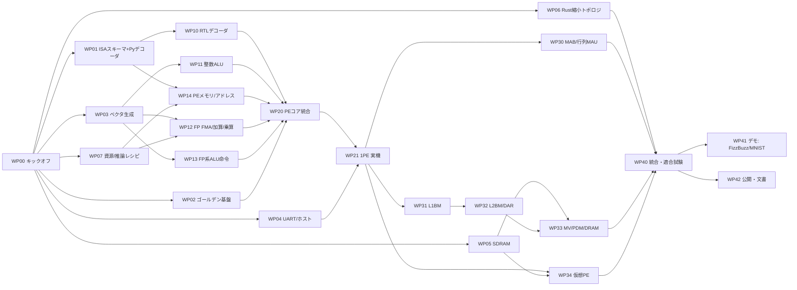

# 05. 工程表（subagent 並列版）

作業は WP（作業パッケージ）単位に分ける。依存関係のない WP は同じ Wave で同時に subagent に割り当てる。
各 WP の指示書は `mncore/wp/WP-xx.md` にある。起動と統合の手順は [wp/LAUNCH.md](wp/LAUNCH.md)。

> **前提の更新（2026-11-24）**
> - Scrapbox の [mncore/機械語](https://scrapbox.io/mncore/機械語) に、ALUC/MAUC/MV/L1BM/L2BM と即値の配置がすでにまとまっている。
> - `assemble3 --print-csv` の出力を連結すると、`j` 語と完全に一致した。
>
> したがって、[03](03-roadmap.md) の P1（エンコード解析）は「CSV からスキーマを生成して往復検証する」作業に縮小した。

## 依存グラフ

## Wave ごとの割り当て

時間はすべて目安。subagent の 1 セッションは数時間程度を想定する。

| Wave | WP（並列） | 主担当の種類 | 完了の目安（実時間） | マイルストーン |
| --- | --- | --- | --- | --- |
| 0 | WP00 | lead（直接作業） | 0.5 日 | リポジトリ、雛形、規約 |
| 1 | WP01、02、03、04、05、06、07（7 並列） | general-purpose | 1〜3 日 | **M0**: スキーマ、ゴールデン、ベクタ、UART、SDRAM が揃う |
| 2 | WP10、11、12、13、14（5 並列） | general-purpose | 2〜4 日 | 各ユニットがベクタで全件一致 |
| 3 | WP20 → WP21（直列） | general-purpose + lead | 2〜5 日 | **M1**: RTL シミュレーション、次に実機で公式 `.asm` の hello/Welcome が一致 |
| 4 | WP30、31、34（3 並列）→ WP32 → WP33 | general-purpose | 1〜2 週 | **M2**: 縮小トポロジ（1 L1B）で L1BM/L2BM/MV が一致 |
| 5 | WP40 → WP41、42 | lead + general-purpose | 1 週 | **M3**: FizzBuzz が実機で動き、公開する |

**合計の目安は実時間で 4〜6 週。** 時間を左右するのは subagent の作業量よりも次の 3 つ。

- 統合時の食い違いの解消（WP20、WP40）
- 実機デバッグ（ボードは 1 台なので直列になる）
- lead とユーザーによるレビュー

## クリティカルパス

WP00 → WP03 → WP12（FP）→ WP20 → WP21 → WP31 → WP32 → WP33 → WP40

- **最長は FP（WP12）。** 独自の浮動小数点形式をビット単位で合わせる作業で、時間が読みにくい。
  WP20 では FP なしの「整数だけの PE」でも先に統合を始めてよい（スタブで差し込む）。こうすれば M1 は FP に左右されない。
- 実機を使うのは WP04、05、21、40、41。ロックで直列にする。

## ユーザーの作業が要る場面

| いつ | 何を |
| --- | --- |
| Wave 0 の前 | GitHub リポジトリ名とライセンスを決める。nano20k を `git init` してよいか |
| Wave 1 | ボードを USB で接続したままにする（WP04、WP05 の実機テスト） |
| 各 Wave の終わり | lead のまとめた報告を確認して、次の Wave へ進めてよいかを判断する |
| WP06 | wogikaze/mncore にブランチや PR を作ってよいか |

## 進捗の管理

- `mncore/status/BOARD.md`（lead が更新）: 各 WP の状態（未着手 / 実行中 / レビュー待ち / 完了 / 保留）、担当 agent、日付。
- Wave を終えるたびに lead が報告書を読み、不整合があれば修正用の WP（`WP-xxf`）を追加する。
